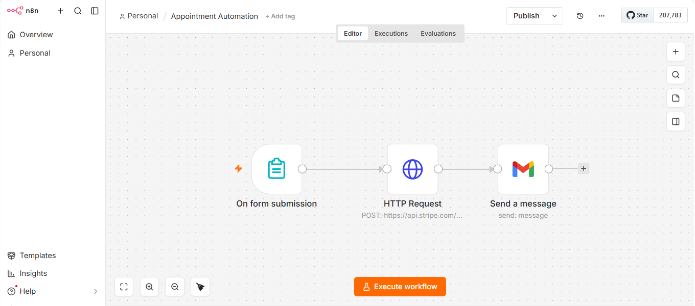

# Appointment Automation (Stripe + n8n)

An appointment booking automation built with **n8n**, **Stripe** (test mode), **Google Calendar** and email. A customer books through a form, pays through a Stripe payment link, and the booking is confirmed automatically.

## What It Does

1. **Booking form:** The customer fills in a booking form.
2. **Stripe payment link:** A payment link is sent to the customer by email.
3. **Stripe webhook:** After payment, Stripe notifies n8n through a webhook.
4. **Google Calendar event:** A calendar event is created for the appointment.
5. **Confirmation emails:** Both the customer and the owner receive a confirmation email.

## Workflows

This project uses two n8n workflows:

- **Appointment Automation:** handles the booking form and sends the Stripe payment link.
- **Stripe Payment Webhook:** receives the payment confirmation from Stripe, then creates the calendar event and sends the emails.

## Tech Stack

- **n8n** - workflow automation
- **Stripe** - payments (test mode)
- **Google Calendar** - appointment scheduling
- **Email** - customer and owner confirmations

## Screenshots

### Appointment Automation Workflow (n8n)

## Note

This project was tested end-to-end in **Stripe Test Mode**. No real payments are processed.

## Author

**Asma Ashraf** - AI Automation Developer
[LinkedIn](https://www.linkedin.com/in/asma-ashraf-9131712bb)
